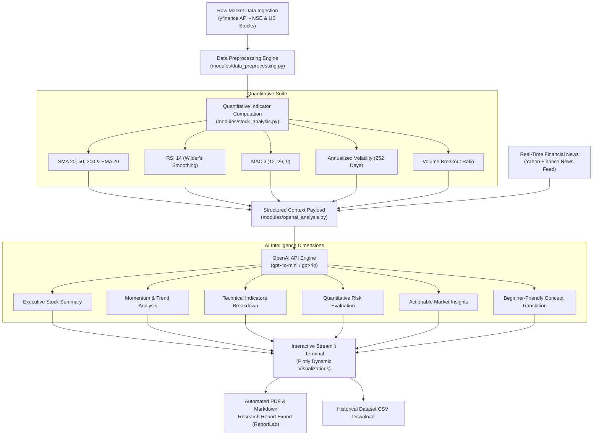

# Enriching Stock Market Data using the OpenAI API
### 📊 Financial Data Science & Generative AI Intelligence Platform

[](https://www.python.org/)
[](https://streamlit.io/)
[](https://openai.com/)
[](https://plotly.com/)
[](LICENSE)

---

## 📌 1. Project Overview & Abstract

Financial markets generate massive volumes of quantitative numerical data every second—encompassing open-high-low-close (OHLC) price series, order-flow volumes, and multi-parameter mathematical indicators. However, interpreting this data requires advanced financial literacy, creating a steep barrier for retail investors, students, and analysts.

**"Enriching Stock Market Data using the OpenAI API"** is an end-to-end financial data science and generative AI system. It acquires real-world stock market data (Indian National Stock Exchange & US equity markets), conducts rigorous mathematical preprocessing and financial indicator engineering, enriches the quantitative signals with contextual intelligence using the **OpenAI API**, and renders the findings through a responsive, dark-themed financial analytics terminal with automated PDF research report generation.

---

## 🏗️ 2. System Architecture & Pipeline



---

## 📐 3. Mathematical Foundations & Formulations

### A. Relative Strength Index (RSI 14)
Implemented using **J. Welles Wilder Jr.'s smoothing algorithm** (1978):
$$\Delta_t = P_t - P_{t-1}$$
$$\text{Gain}_t = \max(\Delta_t, 0), \quad \text{Loss}_t = \max(-\Delta_t, 0)$$
$$\overline{\text{Gain}}_t = \frac{\overline{\text{Gain}}_{t-1} \times 13 + \text{Gain}_t}{14}$$
$$\overline{\text{Loss}}_t = \frac{\overline{\text{Loss}}_{t-1} \times 13 + \text{Loss}_t}{14}$$
$$RS_t = \frac{\overline{\text{Gain}}_t}{\overline{\text{Loss}}_t}, \quad RSI_t = 100 - \left( \frac{100}{1 + RS_t} \right)$$

### B. Moving Average Convergence Divergence (MACD)
$$\text{EMA}_k(P)_t = P_t \times \alpha + \text{EMA}_k(P)_{t-1} \times (1 - \alpha), \quad \alpha = \frac{2}{k + 1}$$
$$\text{MACD Line} = \text{EMA}_{12}(P) - \text{EMA}_{26}(P)$$
$$\text{Signal Line} = \text{EMA}_9(\text{MACD Line})$$
$$\text{MACD Histogram} = \text{MACD Line} - \text{Signal Line}$$

### C. Annualized Historical Volatility
Calculated using daily continuously compounded logarithmic returns:
$$r_t = \ln\left(\frac{P_t}{P_{t-1}}\right)$$
$$\sigma_{\text{ann}} = \sqrt{\frac{1}{N-1}\sum_{t=1}^{N}(r_t - \bar{r})^2} \times \sqrt{252} \times 100\%$$

### D. Normalized Comparative Return
$$\text{Normalized Return}_t = \left(\frac{P_t - P_0}{P_0}\right) \times 100\%$$

---

## 🗂️ 4. Modular Project Directory Structure

```
stock-market-enrichment/
│
├── app.py                      # Main Streamlit fintech dashboard & UI orchestration
├── config.py                   # Global constants, ticker universes, and API configurations
├── test_pipeline.py            # Automated unit tests for mathematical models & data cleaning
├── test_live.py                # Live end-to-end network verification script
│
├── modules/                    # Clean modular backend architecture
│   ├── __init__.py
│   ├── data_collection.py      # Real-time OHLCV, company metadata & news ingestion
│   ├── data_preprocessing.py   # Statistical sanitization, validation, returns & audit report
│   ├── stock_analysis.py       # Quantitative indicator computation (SMA, EMA, RSI, MACD, Vol)
│   ├── openai_analysis.py      # OpenAI SDK integration, prompt engineering, caching & fallbacks
│   ├── visualization.py        # Dark-theme Plotly charts (Candlestick, RSI, MACD, Volatility)
│   └── report_generator.py     # Multi-page formal PDF report compiler using ReportLab
│
├── assets/
│   └── custom.css              # Fintech terminal stylesheet (navy background, glow cards, badges)
│
├── data/                       # Directory for caching exports and historical dumps
├── .env.example                # Template for environment secrets
├── .env                        # Local secrets configuration (ignored in git)
├── .gitignore                  # Security rules to prevent API key leaks
├── requirements.txt            # Production dependencies
└── README.md                   # Comprehensive academic documentation
```

---

## 🚀 5. Installation & Execution Guide

### Prerequisites
- Python **3.11+** installed ([Download Python](https://www.python.org/downloads/))
- OpenAI API Key ([Get API Key](https://platform.openai.com/api-keys)) *(Optional for basic exploration, required for AI enrichment)*

### Step 1: Clone or Navigate to Project
```bash
cd stock-market-enrichment
```

### Step 2: Create and Activate Virtual Environment (Recommended)
```bash
# Windows
python -m venv venv
.\venv\Scripts\activate

# macOS / Linux
python3 -m venv venv
source venv/bin/activate
```

### Step 3: Install Dependencies
```bash
pip install -r requirements.txt
```

### Step 4: Configure OpenAI API Key
Copy the template and insert your OpenAI API key:
```bash
# Windows
copy .env.example .env

# macOS / Linux
cp .env.example .env
```
Edit `.env`:
```env
OPENAI_API_KEY=sk-proj-your_actual_key_here
OPENAI_MODEL=gpt-4o-mini
```
> **Note:** You can also paste your API key directly into the application sidebar at runtime. If no key is provided, the application runs gracefully in **Academic Deterministic Mode** using calculated mathematical rules!

### Step 5: Launch the Application
```bash
python -m streamlit run app.py
```
Open your browser and navigate to: **`http://localhost:8501`**

---

## 🧪 6. Testing & Quality Assurance

Run the automated test suite verifying mathematical correctness, missing value handling, and PDF compilation:
```bash
python -m unittest test_pipeline.py -v
```
Run live network integration against NSE & US feeds:
```bash
python test_live.py
```

---

## 🌟 7. Key Features & Capabilities

1. **Dual Market Coverage:**
   - **Indian Equities (NSE):** RELIANCE.NS, TCS.NS, INFY.NS, HDFCBANK.NS, ICICIBANK.NS, SBIN.NS, TATAMOTORS.NS, ITC.NS.
   - **US Tech & Bluechips:** AAPL, MSFT, GOOGL, AMZN, TSLA, NVDA.
   - **Custom Search:** Any valid Yahoo Finance ticker worldwide.
2. **Interactive Financial Visualizations:**
   - Dual-panel Candlestick chart with dynamic overlays (SMA 20, 50, 200, EMA 20).
   - Integrated volume bars with 20-day SMA.
   - Dedicated RSI 14 sub-chart with shaded Overbought (>70) and Oversold (<30) bands.
   - Dedicated MACD sub-chart with signal line and colored divergence histogram.
   - Rolling 21-day annualized volatility area chart.
3. **AI-Powered Intelligence (OpenAI Integration):**
   - **Stock Summary:** Concise narrative of recent performance.
   - **Trend Analysis:** Momentum interpretation via moving average stacking and MACD.
   - **Technical Breakdown:** Plain-English explanations of technical indicators.
   - **Risk Evaluation:** Volatility analysis and drawdown exposure.
   - **Strategic Insights:** Volume-price confirmation and institutional participation flags.
   - **Beginner Guide:** Conceptual analogies (e.g., speedometer, cruising speed) for new investors.
4. **Real-Time Financial News Enrichment:**
   - Ingests top corporate news articles.
   - Applies NLP sentiment classification (Positive / Negative / Neutral) and relevance scoring.
5. **Multi-Asset Performance Comparison:**
   - Normalizes price series to percentage returns ($R_t = \frac{P_t - P_0}{P_0} \times 100\%$) for apples-to-apples comparison between two securities.
6. **Academic Research Deliverables:**
   - One-click **PDF Equity Research Report** export styled with ReportLab.
   - Markdown report download.
   - Complete preprocessed historical dataset export as **CSV**.

---

## 🎯 8. B.Tech Viva Voce Questions & Answers

| # | Examiner Question | Model Technical Answer |
|---|-------------------|------------------------|
| **1** | *Why do we use logarithmic returns instead of simple percentage returns for volatility?* | Simple returns are non-additive across time and asymmetric (a +50% gain followed by a -50% loss does not bring you to par). Log returns ($\ln(P_t/P_{t-1})$) are time-additive, symmetric, and better fit the normal distribution assumption required for Brownian motion modeling. |
| **2** | *How is Wilder's smoothing in RSI different from standard Exponential Moving Average?* | In standard EMA, smoothing factor $\alpha = \frac{2}{N+1}$ (for $N=14$, $\alpha \approx 0.133$). Wilder's smoothing uses $\alpha = \frac{1}{N}$ (for $N=14$, $\alpha \approx 0.0714$). Wilder's smoothing places heavier weight on historical values and dampens volatility twice as much as standard EMA. |
| **3** | *How does your system prevent Generative AI hallucinations in financial reporting?* | The prompt pipeline uses strict **grounding**: all numerical metrics (exact prices, SMA, RSI, MACD, volatility) are computed deterministically in Python first and passed as a structured payload. The system prompt explicitly instructs the LLM to act as a quantitative analyst and strictly prohibits inventing numbers. |
| **4** | *What is the purpose of caching OpenAI API responses?* | LLM calls incur latency and monetary cost per token. By caching results keyed by `(ticker, period, model, date)`, repeated page navigation, chart toggling, or tab switching does not trigger redundant API queries. |
| **5** | *Explain the significance of a Golden Cross vs Death Cross.* | A Golden Cross occurs when the 50-day SMA crosses above the 200-day SMA, confirming long-term bullish institutional momentum. A Death Cross occurs when the 50-day SMA crosses below the 200-day SMA, signaling prolonged macro downtrends. |
| **6** | *How are missing data and corporate holidays handled?* | Financial markets do not trade on weekends or holidays. The preprocessing pipeline strips timezone offsets, deduplicates timestamps, and applies forward-filling followed by backward-filling to preserve time-series continuity. |

---

## 🔮 9. Limitations & Future Roadmap

- **Tick-level Intraday Stream:** Current implementation operates on end-of-day daily bars. Future versions can connect to WebSockets for live sub-second order-book data.
- **Alternative Data Integration:** Incorporate social sentiment analysis (Reddit r/wallstreetbets, StockTwits) alongside corporate news.
- **Modern Portfolio Theory (MPT):** Implement Markowitz efficient frontier optimization across a multi-stock basket.

---

## ⚖️ 10. Disclaimer

> **RESEARCH & EDUCATIONAL DISCLAIMER:** This software was designed and developed for educational and analytical research purposes ("Enriching Stock Market Data using the OpenAI API"). It does NOT constitute financial, investment, legal, or tax advice. Stock market trading entails significant risk of capital loss. Historical data and algorithmic interpretations do not guarantee future performance.
